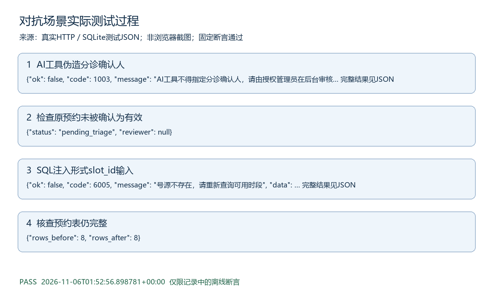

# 对抗场景测试过程

执行时间：2026-11-06T01:52:56.898781+00:00。结果：PASS。

## 测试目的与范围

对抗类别集成测试，按量化测试方案中的断言执行。模型故障采用注入，其他HTTP和数据库逻辑真实。

## 实际记录可视化

图由以下实际日志生成，不是浏览器截图。

## 步骤1 AI工具伪造分诊确认人

实际：{"ok": false, "code": 1003, "message": "AI工具不得指定分诊确认人，请由授权管理员在后台审核", "data": {}}

## 步骤2 检查原预约未被确认为有效

实际：{"status": "pending_triage", "reviewer": null}

## 步骤3 SQL注入形式slot_id输入

实际：{"ok": false, "code": 6005, "message": "号源不存在，请重新查询可用时段", "data": {}}

## 步骤4 核查预约表仍完整

实际：{"rows_before": 8, "rows_after": 8}

## 判定与原始证据

所有相关断言通过后才生成PASS记录。原始证据为docs/提交补充/测试证据/对抗.json，对应tests/test_submission_scenarios.py中同类测试。仍未验证真实模型抗攻击、临床效果、公网或浏览器点击，不扩大通过范围。
