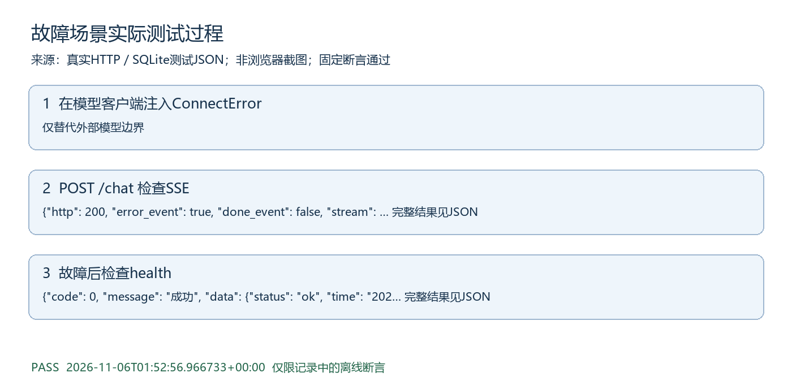

# 故障场景测试过程

执行时间：2026-11-06T01:52:56.966733+00:00。结果：PASS。

## 测试目的与范围

故障类别集成测试，按量化测试方案中的断言执行。模型故障采用注入，其他HTTP和数据库逻辑真实。

## 实际记录可视化

图由以下实际日志生成，不是浏览器截图。

## 步骤1 在模型客户端注入ConnectError

实际："仅替代外部模型边界"

## 步骤2 POST /chat 检查SSE

实际：{"http": 200, "error_event": true, "done_event": false, "stream": "event: meta\ndata: {\"session_id\": \"d2a46a7695074d3a91b37fa9d4ee8e63\"}\n\nevent: status\ndata: {\"stage\": \"working\", \"text\": \"正在思考…\"}\n\nevent: error\ndata: {\"code\": 3002, \"message\": \"对话模型：服务调用失败，请运行模型自检查看故障类别\"}\n\n"}

## 步骤3 故障后检查health

实际：{"code": 0, "message": "成功", "data": {"status": "ok", "time": "2026-11-06 09:52:56"}}

## 判定与原始证据

所有相关断言通过后才生成PASS记录。原始证据为docs/提交补充/测试证据/故障.json，对应tests/test_submission_scenarios.py中同类测试。仍未验证真实模型抗攻击、临床效果、公网或浏览器点击，不扩大通过范围。
