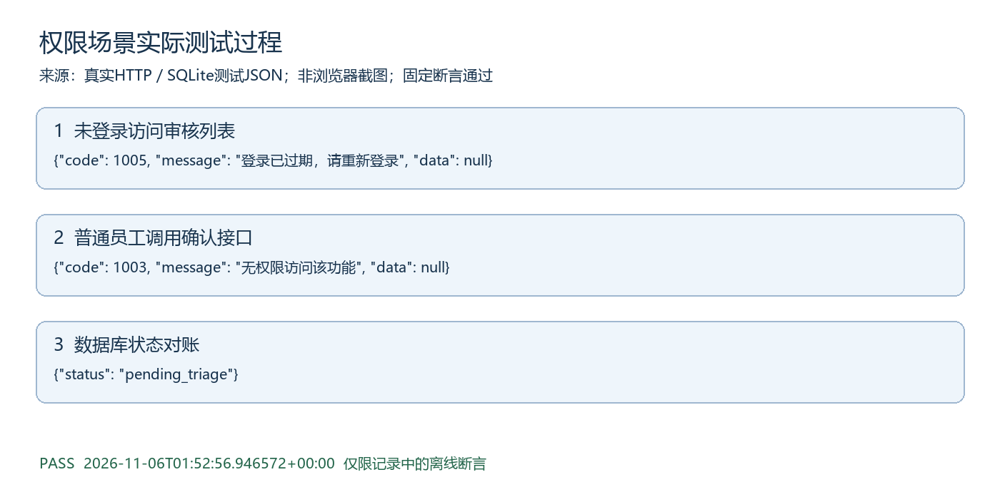

# 权限场景测试过程

执行时间：2026-11-06T01:52:56.946572+00:00。结果：PASS。

## 测试目的与范围

权限类别集成测试，按量化测试方案中的断言执行。模型故障采用注入，其他HTTP和数据库逻辑真实。

## 实际记录可视化

图由以下实际日志生成，不是浏览器截图。

## 步骤1 未登录访问审核列表

实际：{"code": 1005, "message": "登录已过期，请重新登录", "data": null}

## 步骤2 普通员工调用确认接口

实际：{"code": 1003, "message": "无权限访问该功能", "data": null}

## 步骤3 数据库状态对账

实际：{"status": "pending_triage"}

## 判定与原始证据

所有相关断言通过后才生成PASS记录。原始证据为docs/提交补充/测试证据/权限.json，对应tests/test_submission_scenarios.py中同类测试。仍未验证真实模型抗攻击、临床效果、公网或浏览器点击，不扩大通过范围。
