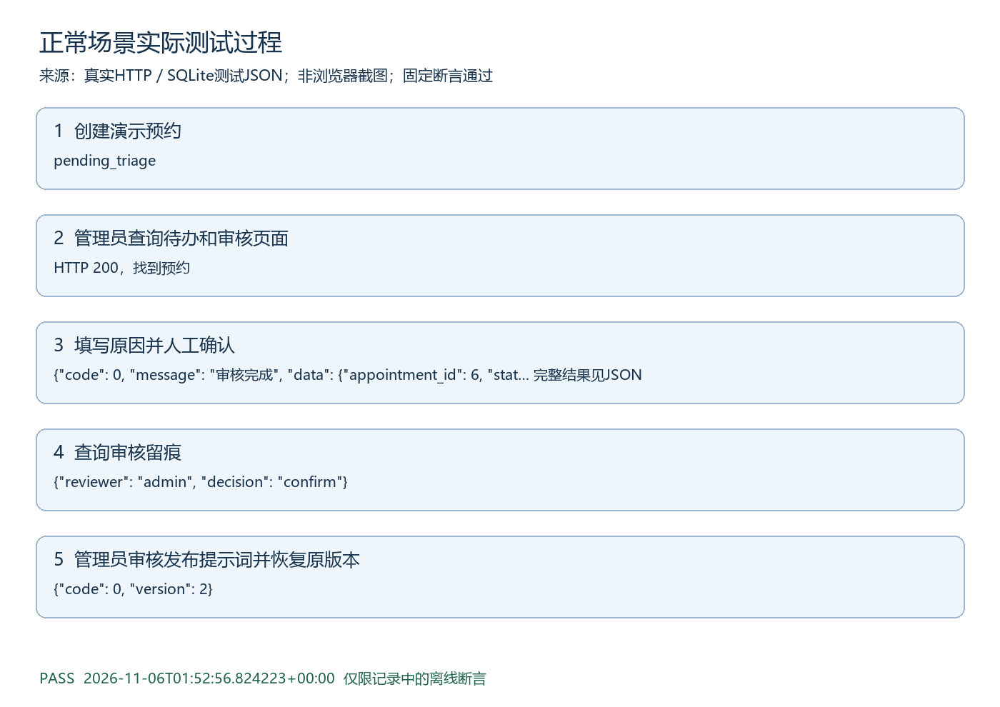

# 正常场景测试过程

执行时间：2026-11-06T01:52:56.824223+00:00。结果：PASS。

## 测试目的与范围

正常类别集成测试，按量化测试方案中的断言执行。模型故障采用注入，其他HTTP和数据库逻辑真实。

## 实际记录可视化

图由以下实际日志生成，不是浏览器截图。

## 步骤1 创建演示预约

实际："pending_triage"

## 步骤2 管理员查询待办和审核页面

实际："HTTP 200，找到预约"

## 步骤3 填写原因并人工确认

实际：{"code": 0, "message": "审核完成", "data": {"appointment_id": 6, "status": "confirmed", "reviewer": "admin"}}

## 步骤4 查询审核留痕

实际：{"reviewer": "admin", "decision": "confirm"}

## 步骤5 管理员审核发布提示词并恢复原版本

实际：{"code": 0, "version": 2}

## 判定与原始证据

所有相关断言通过后才生成PASS记录。原始证据为docs/提交补充/测试证据/正常.json，对应tests/test_submission_scenarios.py中同类测试。仍未验证真实模型抗攻击、临床效果、公网或浏览器点击，不扩大通过范围。
