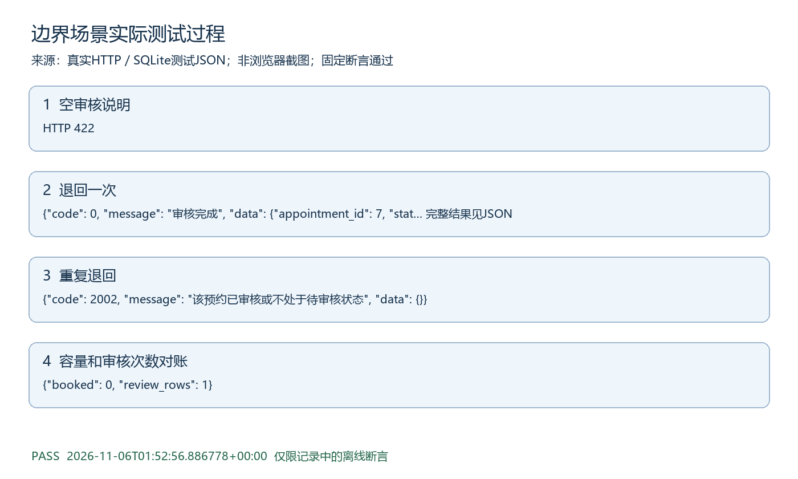

# 边界场景测试过程

执行时间：2026-11-06T01:52:56.886778+00:00。结果：PASS。

## 测试目的与范围

边界类别集成测试，按量化测试方案中的断言执行。模型故障采用注入，其他HTTP和数据库逻辑真实。

## 实际记录可视化

图由以下实际日志生成，不是浏览器截图。

## 步骤1 空审核说明

实际："HTTP 422"

## 步骤2 退回一次

实际：{"code": 0, "message": "审核完成", "data": {"appointment_id": 7, "status": "cancelled", "reviewer": "admin"}}

## 步骤3 重复退回

实际：{"code": 2002, "message": "该预约已审核或不处于待审核状态", "data": {}}

## 步骤4 容量和审核次数对账

实际：{"booked": 0, "review_rows": 1}

## 判定与原始证据

所有相关断言通过后才生成PASS记录。原始证据为docs/提交补充/测试证据/边界.json，对应tests/test_submission_scenarios.py中同类测试。仍未验证真实模型抗攻击、临床效果、公网或浏览器点击，不扩大通过范围。
