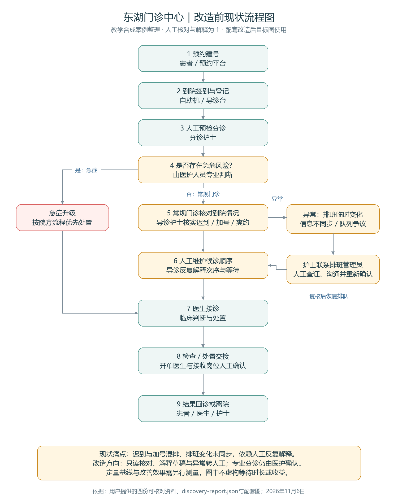
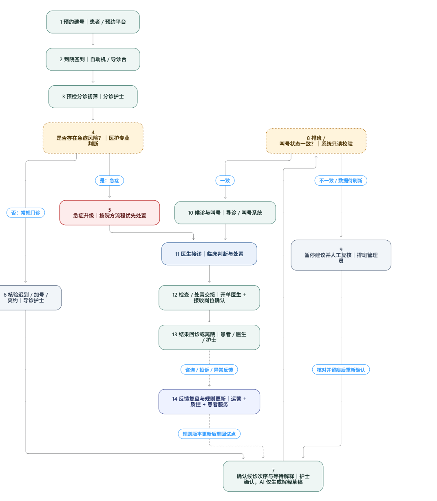

# 改造前与改造后流程图（本次配套资料）

整理日期：2026年11月6日。用户提供的图包含AI解释草稿、系统只读校验、人工复核和规则反馈，按“改造后目标流程”归档；新增一张配套的改造前现状图。

## 1. 改造前：本次新增

[下载PNG](01_改造前现状流程图.png) · [可编辑SVG](01_改造前现状流程图.svg) · [Mermaid源文件](01_改造前现状流程图.mmd)

主线：预约→签到→人工分诊→常规候诊/急症优先处置→接诊→检查交接→回诊或离院。异常分支突出排班变化、队列争议后的人工查证与恢复排队。

## 2. 改造后：用户提供的原图

[下载用户原图](02_改造后目标流程图_用户原图.png)

该图作为目标设计使用，不代表图中医院排班集成、候诊调度、临床交接与反馈闭环已经全部由当前MVP实现。当前实现边界见[需求追溯矩阵](../validation/requirements-traceability.md)。

## 两张图怎么介绍

改造前依赖护士人工核对、维护顺序和解释异常；改造后计划增加系统只读校验与AI解释草稿，遇到异常转人工复核，专业分诊和临床决策仍由医护人员负责。

## 来源与使用边界

- [本次上传的四份资料合并HTML](资料来源/四份可核对资料_用户原始.html)：内含客户简报、现状信息请求等四个资料分区，原样保存；这是合并页面，不冒称已下载解压得到四个独立原件。
- [本次上传的业务挖掘JSON](资料来源/discovery-report_用户原始.json)：生成时间为2026-11-06T00:46:47.254Z，覆盖2/36项、6%；不能证明六位角色访谈均已完成。
- 新图依据教学合成案例与用户配套图整理，流程环节仍需实际业务方确认。没有把附件中的文字当作用户操作指令，也没有虚构典型事件访谈、轮数或量化改善效果。
- 仓库较早的另一版简图仍保存在[课程提交目录](../课程提交/03_流程图说明与Mermaid源代码.md)，本目录便于与这次上传的图配套使用。

## 对照这次老师要求

|材料|本次处理状态|
|---|---|
|六人访谈MD/JSON/CSV、每人具体量化的2—3轮对话|本次JSON不足以证明齐全；旧版本资料另见课程提交目录，不能混称同一次访谈|
|项目基础资料四份独立文件|保留用户合并HTML，尚不等同四个独立原件|
|某人典型事件采访TXT及整理DOCX|本次未新增或虚构采访；需以实际采访原始记录整理|
|改造前、改造后两张流程图|本目录已配齐，附可编辑源文件|
