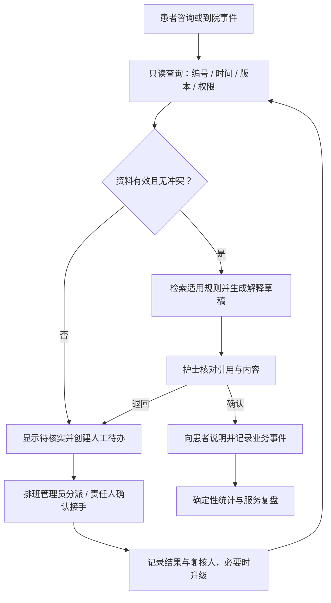

# 东湖门诊中心预约与分诊协作系统需求分析方案

版本：v1.0（待业务方评审）  
编制日期：2026年11月6日  
材料与实现基线：`d17ff37369ee92a075bee53674337eb666294897`  
定位：依据教学合成案例和现有MVP制定的需求建议，不是医院确认需求、临床方案或上线验收结论。

## 一、方案结论与目标

首期建设“有来源的候诊解释与异常协作助手”：先把业务编号、事件时间、排班/队列快照和人工责任对齐，再让AI检索制度、生成解释草稿与交接摘要。专业分诊、患者优先级、叫号调整及对外承诺仍由授权人员确认。

优先解决三件事：

1. 护士能在一个页面核对预约、签到、排班与队列资料，不必反复跨系统询问。
2. 对迟到、加号、排班冲突等情况，生成有依据、带更新时间的解释；无法确认时创建明确的人工待办。
3. 用统一的事件记录计算等待、解释耗时与交接时长，判断改造是否有效。

当前企业员工聊天、制度问答和演示预约能力可以复用，但新增导诊/排班工作台属于待开发范围。已有报销功能保留为扩展，不作为本轮候诊痛点改造的主要验收对象。

## 二、证据来源与可信范围

|编号|仓库材料|用途与限制|
|---|---|---|
|S1|[四份可核对资料合并HTML](流程图补充/资料来源/四份可核对资料_用户原始.html)|客户简报、资料请求表、访谈问题库、角色分工；大量事项明确待核实|
|S2|[2026年11月6日用户导出JSON](流程图补充/资料来源/discovery-report_用户原始.json)|6条对话消息；导诊护士描述迟到/加号混排，引用f10、f12；覆盖2/36项、6%，不是六人访谈全部完成|
|S3|[较早业务挖掘说明与事实索引](课程提交/01_业务挖掘说明与范围映射.md)、[原始JSON](课程提交/01_实验室业务挖掘原始导出.json)|独立训练的36/36项教学事实，供提出需求假设；不能冒充S2同一轮采集或真实现场核实|
|S4|[现有实现与测试追溯](validation/requirements-traceability.md)|确认已有代码、离线测试和未实现部分；自动测试不证明真实模型准确率|
|S5|[改造前后流程图](流程图补充/README.md)|描述现状与目标，目标图中的能力不等于已经上线|
|S6|[旧版需求清单](需求清单.md)|远期设想参考；其中万人并发、全量系统集成和“已评审确定”缺本轮业务签核依据，不作为本方案已确认条件|

事实索引中的f10等均为 `healthcare-appointments-f10` 的简写。S2访谈明确表示报销不在受访岗位职责内，单次解释耗时、迟到与加号占比尚未核实；本方案不补造这些数字。

### 基线、目标与建议不能混用

|事项|材料记录|本方案处理|
|---|---|---|
|工作量|S2/f12：每日1600人次、约180次排队咨询|教学场景规模，需按日期、科室和记录渠道重新核对，不能直接当实测|
|候诊目标|S3/f00：68分钟→40分钟；爽约19%→10%|案例长期目标；起点、分母与周期未统一，不用于证明当前成效|
|试点要求|S3/f02、f42：两个常规门诊，等待下降20%，急症识别提示全部转人工|作为拟议业务验收方向，实施前由业务方批准测量口径|
|数据更新|S3/f34：计划每日两次更新|按计划批次快照设计，不宣称实时数据；实际批次时点、权限待确认|
|预算与留存|S3/f03首期16万元；f43评价记录暂留90天|均为教学条件，待负责人确认；不自动覆盖旧文档预算或审计留存设想|

后文没有来源标记的样本量、性能与质量阈值均为本方案的“建议验收目标”，尚未获业务方批准，也未执行验证。

## 三、痛点与AI适配分析

|痛点|证据|可做的AI改造|必须配套的常规系统能力|优先判断|
|---|---|---|---|---|
|迟到与加号混排，护士反复解释|S2、f10/f12|依据已批准规则与当前快照生成解释草稿；支持通俗化改写|稳定业务编号、明确排序规则、人工确认|高价值、风险可控，首期|
|排班临时变化，通知与实际不一致|f11/f15/f34/f44|汇总冲突点、原记录与待确认字段，辅助核对|版本/更新时间校验、暂停对外建议、人工复核队列|首期先做校验和待办，不能靠AI猜测正确状态|
|跨岗信息留在便签或群聊，交接不完整|f14/f23/f25|把已核实事件整理成交接摘要|接手人、接手确认、超时升级、状态流转|首期先建责任闭环，摘要后续增强|
|签到重复、叫号遗漏、等待起点不一致|f31/f33/f50/f53|后续可辅助描述异常，不负责修复原始业务记录|去重、事件校验、人工修复和统一指标口径|首期前置条件，主要是数据工程|
|制度解释口径不一致，规则可能冲突|f24/f45/f55|基于版本化制度的检索增强问答，列引用与冲突|规则负责人、适用范围、生效日期、审批发布|首期可复用现有RAG|
|缺少可靠的改善效果证据|f01/f02/f51/f53|后续生成有数值来源的周报草稿|指标计算、样本标记、人工核验|先计算再生成，不能用AI估算业务收益|

不是所有痛点都需要大模型。数据去重、容量控制、超时提醒、权限校验和等待时间计算必须由确定性程序完成；大模型主要承担理解、检索与草稿表达。

## 四、角色与责任

|角色|主要操作|不得替代的责任|
|---|---|---|
|患者/员工|提出咨询、补充必要信息，查看经确认的解释|不能读取其他人的就诊记录|
|导诊护士|核对现场信息、审核解释草稿、发起异常|专业判断按岗位和院方流程执行，不由AI代签|
|排班管理员|核实排班、分派异常、确认接手及处理结果|不能代替临床专业签核|
|系统工程师|导入只读数据、处理去重和同步故障|不能修改医嘱或借用业务账号|
|医疗质控专员|审核规则与风险场景、批准试点或要求暂停|AI不能绕过其停止决定|
|患者服务主管|核实解释质量、投诉关联及服务指标|不能以“已发送消息”视为交接完成|
|门诊运营主任|批准范围、资源与验收口径，协调升级|不得以效率指标覆盖临床优先级|

上述责任分配依据S3提出，实际账号权限、代理关系和最终验收人须在启动评审确认。

## 五、需求优先级与实施边界

P0＝进入试点之前必须具备；P1＝P0完成后的效率改进；P2＝数据充分后另行评估；P3＝不纳入本轮。此优先级按痛点直接性、风险、资料可得性和依赖关系综合判断，不是功能越“智能”越优先。

|需求ID|功能与AI作用|优先级/依赖|当前状态|需求边界与验收ID|
|---|---|---|---|---|
|REQ-01|只读资料核对：预约、排班、签到、叫号统一查询；规则程序判断缺失、重复、过期、冲突|P0，无AI前置|演示号源已有，真实状态统一视图待建|只读授权数据，歧义记录转人工，不自动修补HIS；AC-01|
|REQ-02|制度RAG问答：检索适用版本，生成带来源的回答|P0，依赖规则版本及权限|现有RAG可复用，版本治理和效果待验证|只回答有依据的制度问题；缺失或冲突不擅自选答案；AC-02|
|REQ-03|候诊解释草稿：解释迟到/加号规则、核实状态和下一步|P0，依赖01/02/05|现有聊天可复用，现场解释工作台待建|护士审核后才能对外；不生成精确接诊时间、不改排序、不承诺疗效；AC-03|
|REQ-04|异常人工协作：缺依据、状态冲突、更新逾期、紧急提示时建待办并闭环|P0，依赖01/05|错误提示已有，责任待办闭环待建|明确触发原因、责任人、接手和处理时间；AI只辅助描述，不能自动认定已解决；AC-04|
|REQ-05|权限、规则版本及审计：角色校验、记录来源/版本/人工修改、发布与撤回|P0，贯穿全部|后台鉴权和部分轨迹已有，真实员工身份与完整签核待建|模型参数不能指定临床确认人或提升权限；未经授权不外发就诊数据；AC-05|
|REQ-06|事件与指标看板：分别计算预约、到院、签到及接诊相关等待|P0，依赖01/05|现有会话看板可复用，业务事件统计待建|程序计算，保留缺失/剔除记录与原因；AI不生成原始统计值；AC-06|
|REQ-07|AI交接摘要：从已核实记录提取事件、依据、待办、责任与版本|P1，依赖04/05|待建|缺字段标记待确认，不补造责任人、签核或结果；AC-07|
|REQ-08|AI复盘草稿：汇总误判与投诉类别，引用已计算指标|P1，依赖06和足够样本|待建|仅供审核，不自动发布新规则、不宣称因果收益；AC-08|
|REQ-09|等待时间区间预测、动态队列优化建议|P2，需要稳定且经授权的历史事件、漂移评估与专项审批|未实现|先离线评估；首期不做，禁止自动调号；另行制定预测误差和公平性标准|
|REQ-10|自主临床分诊、诊断、医嘱、自动调序、自动赔偿/财务付款|P3，本轮排除|无本轮授权|不接受模型调用这些写操作；扩展必须重新评审|
|REQ-11|企业报销、OA/财务/企微全集成、独立App、万人并发|P3，本轮排除|报销部分工具已有，其余未全实现|保留已有演示能力，不扩展为本次主线，不以旧需求清单宣称已交付|

P0最小可用闭环：一份授权快照＋一套生效规则→护士核对→AI解释草稿→人工审核→异常接手→事件及审计记录。没有排班/队列数据授权时只能做合成回放，不承诺院内实时辅助。

## 六、目标业务流程与典型场景

紧急情况不等待AI生成完成：现场继续按院方人工流程处置，系统提供立即人工联系入口。若输入或规则命中待升级信号，应中止普通自动解释并记录转人工；未命中信号也不代表不存在风险。

### 场景A：迟到与现场加号同时咨询

护士按业务编号读取相关记录和规则→核对更新时间→系统生成“已知状态、规则依据、待核实内容、下一步”四块草稿→护士修订并确认→记录说明时间和再次咨询事件。AI不得自行判定谁先就诊。

### 场景B：医生处理急诊，排班快照与现场不一致

护士报告冲突→系统将快照标为待核实，暂停确定性时间承诺→生成包含原版本的异常待办→排班管理员明确接手人→核对后附处理依据及确认时间→复核后恢复解释。原记录不得被AI覆盖。

以上是拟设计的验收场景，不是新取得的具体患者事件；日期、单次耗时、患者数量等需从脱敏原始记录补齐。

## 七、数据、接口与安全需求

### 最小数据集

|对象|必须字段|校验与责任|
|---|---|---|
|业务关联|业务编号、脱敏就诊标识、科室、预约时段|工程师校验主编号；一人多次就诊分开关联|
|状态快照|来源系统、源版本、采集时间、最后成功更新时间、有效期/下次应更新时点|超过约定更新周期标待刷新；不能把每天两次快照当实时号源|
|事件|事件ID、业务编号、事件类型、发生时间、接收时间、来源、撤销/更正关联|按来源和事件ID去重；时序异常入修复队列，保留更正链|
|规则|规则ID、版本、生效区间、适用科室、责任人、审批状态、来源位置|同范围版本冲突停止自动回答；历史规则不静默覆盖|
|人工待办|业务编号、原因、当前责任人、状态、分派/接手/解决时间、处理依据、复核人|未接手不能标完成；超时升级到运营负责人|
|AI输出与审计|输入来源ID、规则/快照版本、模型配置标识、草稿、人工改动、确认人、时间|不记录密钥；业务身份来自服务端，不能信任模型自行填报的确认人|

拟新增待办状态：待分派→待接手→处理中→待复核→已关闭；退回必须附原因并指向下一责任人。紧急升级单独标记，不受普通待办期限约束。

### 接口与故障边界

首期只读排班和队列，接入前确认接口文档、字段映射、授权和更新计划。无可用接口时允许受控导入CSV快照用于回放，并显著显示非实时来源。待办写入本系统，不回写医院优先级、医嘱或排班。

接口中断保留上次快照和时间，显示“暂未更新”；停止依赖当前状态的确定性建议。恢复后按业务编号与事件ID去重补齐，同一异常未关闭前不重复建相同待办。人工业务持续可用。

现有后台管理员与员工demo账号不足以证明真实患者身份和临床签核权限。进入院内试点前必须补齐真实身份映射、最小角色授权及越权测试。临床确认字段只能由授权人员操作，不接受AI传参作为签核凭证。

默认不把可识别患者资料发送给未获批准的外部模型。现有代码支持云端与本地供应商，不等同已实现私有部署或完成安全测评。试点评价记录90天仅为S3教学建议，实际留存类别、期限与删除审批由组织另行确定；与旧文档180天审计设想的差异须单独决策。

## 八、可执行验收标准

以下均为“拟验收”，状态为NOT_RUN。当前仓库已有34项后端、6项前端离线测试，仅证明原有特定应用断言通过，不能当作本表需求已验收。

### 1. 固定回放集

建议建立200个独立脱敏/合成案例：80个常见规则咨询、40个迟到/加号解释、30个缺失/重复/冲突或过期数据、20个待人工升级输入、15个权限/注入输入、15个断网/重试/恢复输入。每例预先标注业务编号、规则版本、预期处理路径、禁止输出和审核人。

由导诊、排班及质控共同确认标准答案与升级标签；开发者不能仅用自己的模型输出作为标准答案。调参集与验收集分离；多个轮次归属于同一案例，不重复计为多次成功。

|验收ID|对应需求|测试操作与建议通过标准|证据与签核|
|---|---|---|---|
|AC-01|01|对相关30个数据异常案例全部识别并阻断确定性建议；正常关联编号、来源、版本完整；重复导入同一批数据不增加重复事件|导入记录、隔离队列、去重前后对账；工程师与排班管理员|
|AC-02|02|80个规则咨询中至少76个经业务评分为正确且有有效引用；20个另选的无依据/版本冲突负例全部明确不确定或转人工；编造条款/比例=0|逐例输出、证据位置、规则版本和人工评分；质控确认|
|AC-03|03|40个解释场景至少36个经护士评为可用（不修改事实即可使用）；40/40显示来源时间；未经人工确认对外发送次数=0；自行给精确接诊时点或改队列=0|草稿与修改差异、确认与发送日志；导诊及服务主管|
|AC-04|04|对30个数据异常及20个待升级输入，全部进入相应人工路径；待办原因/责任人/接手时间可追溯；未接手误标完成=0；普通待办到测试配置期限时全部触发升级|完整待办状态轨迹和升级记录；排班及质控。普通接手时限建议先按10分钟回放，真实阈值待排班确认|
|AC-05|05|15个越权/注入案例无一获得未授权资料或签核；任何可对外使用的输出都可追溯至资料版本和真实确认身份；停用规则不再参与新回答|访问拒绝记录、规则发布/撤回记录、审计重建；工程师及质控|
|AC-06|06|对固定事件样本由独立参考计算复算，等待时长结果误差不超过1秒；分母、剔除数及原因完全一致；负时长不得计入有效样本|事件CSV、统计程序版本、人工复算表；运营及服务主管|
|AC-07|07|30个独立交接样本中至少27个摘要可用；业务编号、责任人、未解决事项和版本等关键字段不臆造；缺失关键字段全部标待确认|原记录—摘要—人工改动对照；排班管理员|
|AC-08|08|4份独立周期样本周报的数字与确定性统计结果全部一致，每条结论均可追溯；不得把相关性写为因果或直接发布规则|周报草稿、引用数据和批准记录；运营及服务主管|
|AC-09|跨功能|15个故障/重试案例全部显示明确错误或降级状态；异常去重、重试不重复写入；恢复后业务编号对账一致；不存在模型输出可直接改写临床记录的工具路径|故障注入、数据对账及工具白名单检查；工程师和质控|

负例20个、交接30个、周报4份为上述200例之外的专项集，独立编号；不混入模型正确率分母。正确/可用的评分清单须在执行前冻结，列出必要事实、引用和禁止事项。关键越权、伪造签核、自动调序、漏走已标注人工升级路径等单例失败即停止进入下一阶段，不能被总体通过率抵消。

“全部转人工”只针对已标注的固定测试集与系统已触发的信号，不代表真实临床风险识别具有100%覆盖。

### 2. 性能与体验建议目标

在明确记录的部署环境下，以10个并发查询、持续10分钟作为首期功能负载：不含大模型的只读接口P95≤2秒；AI请求30秒超时后展示可操作的重试/人工入口，普通问题不得静默空答。护士应能在同一工作台完成“核对—看草稿—确认/转人工”，不要求切换到新App。

这些是建议的低规模试点指标，不是旧清单3000QPS、P99<500ms的已达标证明。模型生成性能与业务数据库性能分别报告。

## 九、试点业务验收与测量口径

仅在历史回放通过、数据授权、规则审核及人员培训完成后，才考虑两个常规门诊的人工并行试点。建议基线与试点各至少10个工作日、各至少200条有效就诊事件；实际周期按病例量和业务方批准方案调整。始终保留人工原流程。

### 口径与目标

|指标|计算口径|拟验收目标|
|---|---|---|
|主等待指标W1|首次实际接诊时间－有效签到时间，单位分钟；转诊/更正签到按预定规则处理|试点中位数较同口径基线下降≥20%，源于案例试点要求|
|到院等待W2|首次接诊时间－到院时间，仅纳入到院时间有效记录|分开报告，不能把缺少到院记录的样本替换为签到起点|
|预约偏差W3|首次接诊时间－预约时段约定起点；允许负值反映提前接诊|独立报告，不与W1混算|
|解释耗时|单次解释结束－开始；同一业务的再次解释另记次数并可汇总总耗时|建议中位数下降≥20%，先取得基线再由导诊批准|
|咨询工作量|人工排队咨询次数/有效到诊人次×100|建议下降≥15%，避免不同到诊规模造成错觉|
|人工接手|成功接手异常单数/应接手异常单数；记录超时数和未解决数|有效人工接手与已触发紧急升级路径完整记录；超时逐单复盘|
|保障指标|漏关联事件、人工改写事实、投诉与关键违规|关键违规=0；投诉变化单独报告并人工归因|

业务方需在试点前锁定同科室、可比时段、医生出诊数量、纳入/排除规则、缺失比例和统计周期；按科室分别报告再合并，保留全量分母。排班取消、急诊占用等特殊事件单列，不能事后仅剔除慢病例。样本不足、缺失超出预先约定阈值或基线不可比时结论为“证据不足”。

下降率＝（基线中位数－试点中位数）/基线中位数；基线为0时不计算比例。68→40分钟与19%→10%不作为此次已达成效果；本轮不承诺爽约率改善。即便达到20%，无适当对照也不能断言全部变化由AI导致。

暂停条件：出现越权泄露、AI擅自执行临床/调序动作、确认后引用错版规则、已标注应升级事件未走人工路径，或发现影响排序的数据不可用时，立即暂停相关自动辅助，由质控决定复盘和恢复。效率指标达标不能覆盖这些问题。

## 十、交付阶段与验收责任

|阶段|交付内容|进入下一阶段的条件|
|---|---|---|
|D0 需求核实|六岗位补访、典型事件证据包、接口与数据字典、规则负责人、指标口径|运营确认范围；质控确认边界；数据持有人确认授权|
|D1 最小回放闭环|P0只读工作台、RAG、解释审核、异常接手、审计和统计|AC-01至AC-06、AC-09通过，缺陷与未完成项可追踪|
|D2 小范围并行|两个常规门诊、原流程兜底、培训、对照测量与每周复盘|业务指标按同口径评价，质控无停止项；业务负责人签署继续/修改/停止意见|
|D3 效率增强|P1摘要与复盘；P2预测只做可行性评估|AC-07/08通过；预测/调序另起评审，不自动进入上线范围|

阶段不预设已经发生的日期或未经评估的工期，估算需在D0确认接口条件和人员可用性后形成。成本至少区分开发、集成、模型/算力、培训、人工审核、维护与验证；既有26,400元教学报价和案例16万元预算不直接等同本方案合同价。

交付清单：需求追溯表、脱敏数据字典、版本化规则包、回放样本与冻结标准、可运行MVP、逐例验收结果、异常/审计导出、业务指标报告、风险与回退说明。未运行标NOT_RUN，不用截图代替逐例证据。

## 十一、启动前必须补核实的问题

1. 请导诊护士围绕同一业务编号补2—3轮：何时到院/签到、谁处理、何时解释、哪里冲突、最终怎么解决？每项量化值附来源，无法取得则记未知。
2. 请排班管理员与工程师核对该事件的预约、排班、叫号和版本；确认是否真有只读接口及每日两次更新的具体时点。
3. 请运营与服务主管确认等待起点、咨询次数去重方法、工作日及分母；对1600人次/180次咨询先取样复核。
4. 请质控确认人工升级标签、权限、停止条件和数据留存；明确模型部署方式及哪些资料允许进入模型。
5. 核实S2两角色的有限对话与S3独立训练事实是否一致，不把两份材料合并成虚构的同一次六人深访。
6. 对“专业确认人可由工具参数传入”、规则冲突、真实身份、无数据时的回答逐项做实现审查。现有pending_triage演示状态不是完整医护签核机制。

## 十二、需求变更与版本管理

每项新需求建立Issue，写清来源、需求ID、优先级、边界和验收案例。PR关联Issue及实现与测试，业务规则变更记录版本和批准人；失败、人工改写和不确定证据保留。涉及临床权限、医院写接口、对外承诺或新增个人资料的变更，重新开展范围和验收评审。

本方案是可评审的需求基线。D0完成前不将“建议目标”改成“客户已确认”；后续更新通过版本记录明确差异。
